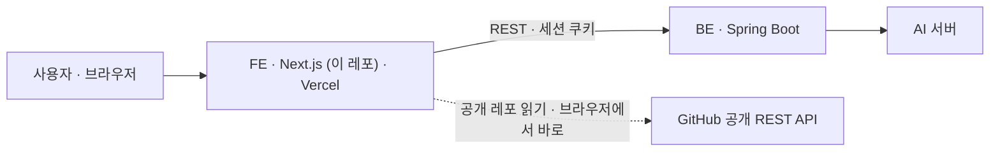
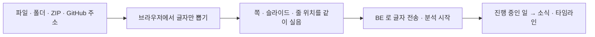

# WOOWANGTHON_TEAM_12_FE — 차곡 프론트엔드

2026 AI 우왕톤 12팀 「내가 우왕이 될 상인가」 — **차곡**: 흩어진 기록은 차곡차곡 정리하고, 지원서엔 딱 맞게 꺼내 쓰는 AI 동료.

**서비스: https://app-woowang.miroda.live** (main 이 올라갈 때마다 Vercel 이 자동 배포). 심사용 테스트 계정은 제출 폼에 있다.

프로젝트 개요 · 문제 · AI 검증 · 아키텍처 · 결정 기록은 [ETC 레포](https://github.com/woowangthon/WOOWANGTHON_TEAM_12_ETC)에 있다. 스택을 고른 이유는 ETC [ADR-005](https://github.com/woowangthon/WOOWANGTHON_TEAM_12_ETC/blob/main/docs/decisions/ADR-005-fe-stack.md).



## 이 레포가 맡는 것

- 화면 전부 — 홈 입력(차곡이) · 내 경험(연도별 타임라인 · 활동 세부 · STAR · 근거) · 지원서(문항 · 공고 · 초안) · 작성 지침 · 외부 AI 연결 · 공개 프로필
- 자료 글자 뽑기 — PDF · PPTX · Notion ZIP · 옵시디언 폴더 · GitHub 공개 레포의 글자를 **브라우저에서** 뽑아 글자만 BE 로 보낸다(서버에 파일을 올리지 않는다)
- 데이터 판단은 하지 않는다 — 저장 · 인증 · AI 호출은 전부 BE API 로. AI 호출이 실패하면 정해 둔 답으로 덮지 않고 오류와 「다시 시도」를 보인다

## 화면

| 화면 | 주소 | 하는 일 |
| --- | --- | --- |
| 홈 | `/` | 입력 하나(차곡이) — 넣은 글을 자료(쌓기)와 문항 · 공고(지원)로 가르고, 한 줄 질문에 근거 달린 경험으로 답한다(꺼내기) |
| 내 경험 | `/experience` | 연도별 타임라인 · 서랍 · 활동 세부(경험 줄 · 근거 · STAR 칸 · 보완) · 그 자리에서 고치기 · 옮기기 · 합치기 · 지우기 · 원문 보기 · 수정 이력 |
| 지원서 | `/questions` | 지원 넣기(붙여넣기 · 링크 · 캡처 · 자주 나오는 문항) → 공고 확인 → 공고 탭(공고 줄마다 내 근거) · 문항 탭(추천 · 되묻기 · 초안 · 근거 점검 · 확정) · 옆 패널 차곡이 |
| 내 지원서 | `/applications` | 넣은 지원을 시기별 · 지원처 종류별로 묶어 보고 상태(작성 중 · 냈음 · 합격 · 불합격 · 모름)를 고친다 |
| 작성 지침 | `/guidelines` | 들은 작성법을 지침으로 쌓고, 켜 둔 지침으로 초안의 결을 맞춘다 |
| 연결 | `/connections` | MCP 연결 주소 · 쓰기 켜기 · 외부 AI 변경 기록(맞아요 · 되돌리기) · Markdown 내보내기 · 공개 프로필 |
| 공개 프로필 | `/p/{token}` | 고른 경험만 실린 읽기 전용 페이지(로그인 없이) |
| 어디서나 | `Ctrl K` | 빠른 찾기 — 경험 찾기 · 차곡이에게 묻기 · 바로가기 · 진행 중인 일 · 소식 |

화면 하나하나의 동작은 ETC [`docs/SPEC.md`](https://github.com/woowangthon/WOOWANGTHON_TEAM_12_ETC/blob/main/docs/SPEC.md), 모양은 [`docs/design/DESIGN.md`](https://github.com/woowangthon/WOOWANGTHON_TEAM_12_ETC/blob/main/docs/design/DESIGN.md).

### 파일을 넣는 길 — 입력 → 처리 → 출력

파일은 **브라우저에서 글자만** 뽑아 `.md` · `.txt` 와 같은 길로 보낸다. 원본 파일을 서버로 올리지 않고, AI 도 OCR 도 쓰지 않는다.



- PDF 는 `pdfjs-dist` 로 쪽 단위 글자를, PPTX 와 Notion ZIP 은 `JSZip` 으로 슬라이드 · 페이지 글자를 읽는다. 쪽 · 슬라이드 순서와 줄 번호가 BE 에 남아, 근거를 열면 몇 쪽 · 몇 번째 슬라이드인지 보인다.
- 글자를 하나도 못 읽는 파일(스캔 PDF · 그림뿐인 슬라이드)은 넣지 않고 「텍스트로 붙여 넣어 주세요」로 돌아간다. 글자를 지어내지 않는다.
- 공개 GitHub 레포는 GitHub 공개 REST API 를 **브라우저에서** 부른다(비인증은 IP 당 시간당 60회라 서버 하나에 요청이 몰리지 않게). 계정 연동은 하지 않는다.
- 넣기 전에 「외부 AI(OpenAI)로 보내져 분석된다」가 보인다.

## AI 가 한 것을 화면에서 어떻게 보이나

초안 · 추천 · 분류는 AI 가 만들지만 **무엇이 사실인지는 화면이 숨기지 않는다**. 구분은 BE 가 데이터에 저장하고, 화면은 **사실이 아닌 것만** 표시한다([ADR-018](https://github.com/woowangthon/WOOWANGTHON_TEAM_12_ETC/blob/main/docs/decisions/ADR-018-show-only-exceptions.md)).

| 표시 | 뜻 | 모양 |
| --- | --- | --- |
| `AI` 배지 | AI 가 붙인 해석(역량 · 분류 · 문항 유형 · 추천 이유). 사용자가 고치면 사라진다 | 값 옆 회색 배지 |
| 「AI 가정」 | 자료에 없는 장면을 합격 답 패턴에 맞춰 쓴 초안 문장. 확인하면 그 경험에 쌓인다 | 물결 밑줄(주황 계열) |
| 「확인 필요」 | 근거가 원본에서 안 찾아졌거나 외부 AI 가 고친 경험 | 호박색 꼬리표 |
| 초안의 근거 · AI 보탬 · 빈칸 · 생각 | 문장 종류 — 눌러서 근거 원문을 본다 | 밑줄 · 강조 · 점선(색에만 기대지 않는다) |
| ✦ | 누를 때마다 **분석 횟수를 쓰는 버튼**에만 붙는다. 남은 횟수와 설명은 계정 메뉴에서 본다 | 버튼 앞 ✦ |

- AI · API 호출이 실패하면 **오류 상태와 다시 시도**를 보인다. 정해진 답으로 돌아가는 코드는 없고, 필요하면 `MOCK` 으로 표시한다(대회 규칙).
- 색은 한 색에 한 뜻이다. 호박색은 「사용자가 정할 것」에만 쓴다. 상태를 색만으로 가르지 않는다.

## 스택

- Next.js 16 (App Router) · React 19 · TypeScript
- Tailwind CSS 4 · shadcn/ui 부품(button · sheet · dialog — 레포에 복사해 디자인 기준대로 고침)
- pdf.js(`pdfjs-dist`) · JSZip — PDF · PPTX · Notion ZIP 글자 뽑기
- 시험: Playwright · 린트: ESLint(`eslint-config-next`)
- 배포: Vercel — main 만 운영으로 자동 배포. PR 미리보기는 없다(ETC ADR-020)

## 기술 선택과 이유

| 정한 것 | 이유 | 버린 안 | 기록 |
| --- | --- | --- | --- |
| Next.js 16(App Router) · React 19 · TypeScript · Tailwind CSS 4 | 라우팅 · 화면 틀을 기본값으로 시작하고, 데이터 · 인증 · AI 호출은 전부 BE API 로 둔다(Next.js 의 서버 기능으로 BE 일을 하지 않는다) | Vite + React SPA(Cloudflare Pages) · FE 도 Compose 에 함께 | [ADR-005](https://github.com/woowangthon/WOOWANGTHON_TEAM_12_ETC/blob/main/docs/decisions/ADR-005-fe-stack.md) |
| Vercel 은 main 만 운영으로 자동 배포, PR 미리보기는 끈다 | 미리보기가 하루 배포 한도(100)에 쌓여 운영 배포까지 막혔다. 미리보기는 목 모드라 지원서 화면을 못 보였다 | Ignored Build Step · Pro 요금제 | [ADR-020](https://github.com/woowangthon/WOOWANGTHON_TEAM_12_ETC/blob/main/docs/decisions/ADR-020-no-pr-preview.md) |
| FE 와 BE 를 같은 상위 도메인에 둔다(`app-` · `api-`) | 세션 쿠키 · CORS 가 단순해진다. 그래서 `*.vercel.app` 에서는 실제 API 를 못 부른다 | 서로 다른 도메인 | [ADR-004](https://github.com/woowangthon/WOOWANGTHON_TEAM_12_ETC/blob/main/docs/decisions/ADR-004-deploy.md) |
| 파일 글자는 브라우저에서 뽑는다 | 원본 파일을 서버로 올리지 않고, GitHub 비인증 한도(IP 당)가 서버 하나에 몰리지 않는다 | 서버(BE · AI)에서 받기 | SPEC S-39 · S-64 |
| shadcn/ui · Radix 부품을 복사해 DESIGN 기준으로 고쳐 쓴다 | 접근성이 갖춰진 부품에 색 · 크기만 우리 기준으로 | 부품 라이브러리를 그대로 쓰기 | `src/components/ui/` |
| `cacheComponents` 로 방문한 화면을 상태째 보관한다 | 화면을 오가도 입력 · 목록이 남아 전환이 빠르다. 대가로 돌아온 화면에 이전 상태가 남아, 주소로 들어온 뜻에 맞춰 닫거나 여는 처리를 따로 두었다 | 매번 새로 그리기 | `next.config.ts` |

## 직접 구현 vs 외부 기술

표 전체와 출처는 ETC [`docs/ai-scope.md`](https://github.com/woowangthon/WOOWANGTHON_TEAM_12_ETC/blob/main/docs/ai-scope.md) §1 · §4.

| 직접 구현 | 가져다 쓴 것 |
| --- | --- |
| 화면 전부 · 그 자리 고치기 · 타임라인 · 지원 화면 · 초안 교정 화면(문장 표시 · 근거 카드) | Next.js · React · TypeScript · Tailwind CSS |
| 브라우저 파일 글자 뽑기의 쪽 · 슬라이드 · 줄 맞추기, Notion ZIP · 옵시디언 폴더 · GitHub 커밋 · PR 읽기 | `pdfjs-dist` · `JSZip` · GitHub 공개 REST API |
| 로그인 문 · 세션 만료 처리 · 하루 분석 한도 표시 | shadcn/ui · Radix UI · Phosphor 아이콘 |
| 시안과 앱을 같은 폭에서 비교하는 스크립트(`design:diff`) · 시험용 가짜 BE | Playwright · ESLint |

**이 레포에는 LLM 을 직접 부르는 코드가 없다.** AI 기능은 전부 BE → AI 서버를 거친다. AI 모델 · 검증 결과는 [AI 레포 README](https://github.com/woowangthon/WOOWANGTHON_TEAM_12_AI#ai-검증-결과).

## 실행 방법

Node.js 20.9 이상(24 권장)이 필요하다.

```bash
npm install
npm run dev        # http://localhost:3000
```

- **API 주소를 비우면 목 모드**다 — 백엔드 없이 화면을 본다. 로그인이 없고, 목 데이터는 코드에 `MOCK(<id>)` 주석이 달려 있으며 ETC `docs/ai-scope.md` §3 에 전부 등록돼 있다. 목 모드는 **API 주소가 없을 때만** 켜지고, 실제 API 가 실패했을 때 목 결과로 바꾸지 않는다.
- **실제 백엔드에 붙이려면** `.env.local` 에 `NEXT_PUBLIC_API_BASE_URL=http://localhost:8080/api`(로컬 BE — [BE README](https://github.com/woowangthon/WOOWANGTHON_TEAM_12_BE#실행-방법)). 변수 이름은 `.env.example` 에 있다. `NEXT_PUBLIC_` 변수는 브라우저 번들에 들어가므로 비밀값을 넣지 않는다.
- 로그인은 아이디 · 비밀번호 + 서버 세션 쿠키다(ETC `docs/contracts/auth-api.md`). 운영에선 `app-woowang` · `api-woowang` 이 같은 상위 도메인이라 쿠키가 실린다.

## 검증

PR 을 올리기 전에 돌린다. GitHub Actions(`.github/workflows/ci.yml`)도 PR 마다 같은 것을 돌린다.

```bash
npm run check      # = lint → typecheck → build
```

| 명령 | 하는 일 |
| --- | --- |
| `npm run lint` | ESLint |
| `npm run typecheck` | 라우트 타입 생성(`next typegen`) 뒤 `tsc --noEmit` |
| `npm run build` | 운영 빌드 |
| `npm test` | Playwright — 1440 · 1024 · 390px 화면 시험과 API 요청 모양 시험(`tests/`) |

`npm test` 는 처음 한 번 `npx playwright install chromium` 이 필요하다. 3100 포트에 격리된 개발 서버를 띄우고(worktree 여러 개에서 동시에 돌릴 땐 `PW_PORT=3101` 처럼 나눈다) 브라우저 요청을 시험용 응답으로 받는다 — 화면 동작 · 요청 모양을 보는 시험이고 실제 AI 품질 검증은 아니다(AI 품질은 AI 레포 채점 스크립트). 목 모드 회귀 시험은 `TEST_MOCK=1 npm test -- --project=desktop --project=mobile`.

- **CI 는 lint · 타입 · 빌드만 돈다. Playwright 는 CI 에 없다** — 화면 · 문구를 바꾼 PR 은 관련 시험을 직접 돌린다.
- 시험 프로젝트는 `desktop`(1440) · `mobile`(390) · 홈 · 공개 프로필 · MCP · 큰 글자 등으로 나뉘고, 한 번에 하나씩 돈다. 특정 시험만 돌리려면 `npx playwright test tests/<파일> -g "<이름>" --project=desktop`. 설치된 Chrome 으로는 `PW_CHANNEL=chrome`.

## 목 · 샘플 · 테스트 계정

코드의 `MOCK(<id>)` · `SAMPLE(<id>)` 마커는 ETC [`docs/ai-scope.md`](https://github.com/woowangthon/WOOWANGTHON_TEAM_12_ETC/blob/main/docs/ai-scope.md) §3 표와 1:1 이다.

| 구분 | 마커 | 언제 나오나 |
| --- | --- | --- |
| MOCK | `timeline-activities` · `timeline-applications` · `source-analysis` · `experience-search` · `experience-saved` · `public-profile` · `mcp-connection` · `mcp-changes` · `entrance-route` · `entrance-ask` · `application-parse` · `application-parse-url` · `posting-lines` · `home-empty-applications` | API 주소가 **비어 있는 목 모드에서만**. 운영 · 로컬 API 모드에서는 나오지 않는다 |
| SAMPLE | `home-input-examples` · `connection-chat-example` | 홈의 예시 칩은 입력칸만 채우고 결과 · 저장을 만들지 않는다. 연결 화면의 대화 예시는 「예시」로 표시한다 |

- **운영 화면(`app-woowang.miroda.live`)은 목이 아니라 실제 BE · AI 를 부른다.**
- 테스트 계정 비밀번호는 화면 · README 에 적지 않는다 — Public 레포라 제출 폼에만.

## 코드 지도

| 자리 | 하는 일 |
| --- | --- |
| `src/app/(app)/page.tsx` | 홈 — 입력 하나(차곡이) · 쌓인 블록 · 「이어서」 |
| `src/app/(app)/experience` | 내 경험 — 연도별 타임라인 · 활동 세부 · 경험 · STAR · 근거 |
| `src/app/(app)/applications` · `questions` | 지원서 — 문항 · 공고 요건 줄 · 경험 추천 · 되묻기 · 초안 |
| `src/app/(app)/guidelines` | 작성 지침 |
| `src/app/(app)/connections` | 외부 AI 연결(MCP 주소 · 쓰기 켜기 · 최근 수정) |
| `src/app/p/[token]` | 공개 프로필 |
| `src/components/<화면>` | 화면별 부품 — `home` · `experience` · `applications` · `questions` · `source` · `connections` · `revisions` · `export` · `auth` … |
| `src/lib/api` | BE API 호출 — 계약(ETC `docs/contracts/`)과 같은 타입 · 오류 처리. `http.ts` 가 401 이면 로그인 화면으로 |
| `src/lib/source-file` | 자료 글자 뽑기 — `pdf.ts` · `pptx.ts` · `notion-zip.ts` · `github.ts` · `notes.ts`(옵시디언 폴더) |
| `src/lib/mock` | 목 모드 데이터(API 주소가 없을 때만) |
| `tests/` | Playwright 시험 |
| `scripts/design-diff` | 시안과 앱을 같은 폭에서 재서 견주는 도구(아래) |

## 시안과 비교하기

시안 HTML 과 앱을 같은 폭(1440 · 1024)으로 열어, 브라우저가 계산한 값으로 견준다. 코드를 읽어 옮기면 뒤에서 덮어쓴 규칙을 놓친다. **UI PR 에는 이 표를 붙인다.**

```bash
npm run design:diff -- home   # 화면: home · quick-find · add-menu · notifications · experience · apply
```

- 시안은 `../WOOWANGTHON_TEAM_12_ETC/docs/design/chagok`(옆에 클론), 앱은 API 주소를 비운 목 모드로 스스로 띄운다. 실제 서버에 닿지 않는다.
- 결과는 `artifacts/design-diff/<화면>/` — 폭마다 나란한 이미지 `<폭>.png` 와 차이 표 `report.md`. 커밋되지 않는다.
- 이 폴더에서 `npm run dev` 가 돌고 있으면 목 모드 서버를 가리킨다: `npm run design:diff -- home --app-url http://localhost:3000`. 그 밖의 인자: `--widths 1440` · `--etc <ETC 경로>`.
- 화면을 더하려면 `scripts/design-diff/screens/<화면>.json` 하나를 만든다. `pairs` 의 `design` · `app` 은 Playwright 선택자, `open` 은 재기 전에 누를 곳이다. 목 모드에 없는 데이터가 필요하면 `"api": "fake-question"`(시험용 가짜 BE `tests/fake-question-api.ts`) — 이때 `--app-url` 은 API 모드 서버여야 한다.
- 일부러 다르게 둔 값은 ETC `docs/design/DESIGN.md` 「시안과 일부러 다른 곳」에 적고, 짝에 `"intent": { "높이": "이유" }` 를 달면 표에 「의도」로 나온다.

## 배포

- **main 에 머지되면** 운영 URL 이 갱신된다(Vercel).
- **PR 미리보기는 없다** — `vercel.json` 의 `git.deploymentEnabled` 가 main 만 배포한다. Vercel Hobby 하루 배포 한도(100)에 PR 미리보기가 쌓여 운영 배포까지 막혔기 때문이다(2026-11-12 · ETC ADR-020).
- UI PR 은 Playwright 시험(가짜 API)으로 1440 · 1024 · 390 을 찍어 `docs/fe-<번호>/` 에 두고 PR 본문에 붙인다. 개발 서버 배지는 `nextjs-portal { display: none }` 으로 숨기고 찍는다.
- 배포 계정 · 도메인 · 환경 변수는 사람만 다룬다. 레포엔 `.env.example` 만 둔다.

| 주소 | 무엇 |
| --- | --- |
| `https://app-woowang.miroda.live` | 운영 화면. `NEXT_PUBLIC_API_BASE_URL=https://api-woowang.miroda.live/api` 로 빌드된다 |
| `https://api-woowang.miroda.live/api` | 실제 BE. 앱의 로그인(세션 쿠키)으로 막는다 — 팀원만 들이던 Cloudflare Access 는 로그인 · 하루 한도를 붙인 뒤 풀었다(2026-11-14 · BE#21) |
