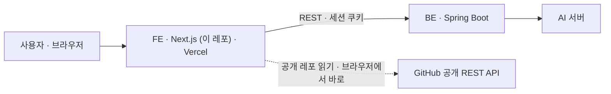
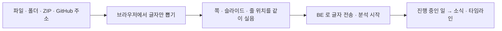

# WOOWANGTHON_TEAM_12_FE

> 차곡의 화면 — 경험을 쌓고, 문항에 맞춰 꺼내고, 초안의 근거를 확인하는 웹 프론트엔드

**운영 URL: https://app-woowang.miroda.live** (main 이 올라갈 때마다 Vercel 이 자동 배포) — 실제 API 를 보려면 먼저 Access 로그인([아래](#운영에서-실제-api-로-보기)). 심사위원 접속 방법과 테스트 계정은 ETC README 「링크」.

2026 AI 우왕톤 12팀 「내가 우왕이 될 상인가」. 서비스 **차곡**은 흩어진 기록에서 근거 달린 경험을 쌓아 두고, 지원할 때 맞는 경험을 꺼내 부족한 사실만 묻는다. 서비스 개요 · 명세 · 아키텍처 · 결정 기록은 [ETC 레포](https://github.com/woowangthon/WOOWANGTHON_TEAM_12_ETC).



## 화면이 하는 일

| 화면 | 주소 | 하는 일 |
| --- | --- | --- |
| 홈 | `/` | 입력 하나(차곡이) — 넣은 글을 자료(쌓기)와 문항 · 공고(지원)로 가르고, 한 줄 질문에 근거 달린 경험으로 답한다(꺼내기) |
| 내 경험 | `/experience` | 연도별 타임라인 · 서랍 · 활동 세부(경험 줄 · 근거 · STAR 칸 · 보완) · 그 자리에서 고치기 · 옮기기 · 합치기 · 지우기 · 원문 보기 · 수정 이력 |
| 지원서 | `/questions` | 지원 넣기(붙여넣기 · 링크 · 캡처 · 자주 나오는 문항) → 공고 확인 → 공고 탭(공고 줄마다 내 근거) · 문항 탭(추천 · 되묻기 · 초안 · 근거 점검 · 확정) · 옆 패널 차곡이 |
| 내 지원서 | `/applications` | 넣은 지원을 시기별 · 지원처 종류별로 묶어 보고 상태(작성 중 · 냈음 · 합격 · 불합격 · 모름)를 고친다 |
| 작성 지침 | `/guidelines` | 들은 작성법(영상 · 멘토 피드백)을 지침으로 쌓고, 켜 둔 지침으로 초안의 결을 맞춘다 |
| 연결 | `/connections` | MCP 연결 주소 · 쓰기 켜기 · 외부 AI 변경 기록(맞아요 · 되돌리기) · Markdown 내보내기 · 공개 프로필 |
| 공개 프로필 | `/p/{token}` | 고른 경험만 실린 읽기 전용 페이지(로그인 없이) |
| 어디서나 | `Ctrl K` | 빠른 찾기 — 경험 찾기 · 차곡이에게 묻기 · 바로가기 · 진행 중인 일 · 소식 |

화면 하나하나의 동작은 ETC [`docs/SPEC.md`](https://github.com/woowangthon/WOOWANGTHON_TEAM_12_ETC/blob/main/docs/SPEC.md), 모양은 [`docs/design/DESIGN.md`](https://github.com/woowangthon/WOOWANGTHON_TEAM_12_ETC/blob/main/docs/design/DESIGN.md).

## 화면이 맡은 일 · 맡기지 않은 일

| 맡은 일 | 맡기지 않은 일 |
| --- | --- |
| 화면 · 그 자리에서 고치기 · 입력 검사(글자 수 · 형식) | 데이터 판단 · 인증 · AI 호출 — 전부 BE API 로(Next.js 의 서버 기능으로 BE 일을 하지 않는다) |
| **브라우저에서 파일 글자 뽑기**(PDF · PPTX · Notion ZIP · 옵시디언 폴더 · 공개 GitHub 레포) | OCR · 이미지 해석 — 글자를 못 읽는 파일은 넣지 않고 붙여넣기로 안내한다 |
| 오래 걸리는 일의 진행을 보여 주기(분석 중 · 실패 · 다시 시도) | 실패를 정해진 답으로 덮기 |
| AI 가 한 것과 사실을 구분해 보이기 | 표시를 근거로 만들기 |

### 파일을 넣는 길 — 입력 → 처리 → 출력

파일은 **브라우저에서 글자만** 뽑아 `.md` · `.txt` 와 같은 길로 보낸다. 원본 파일을 서버로 올리지 않고, AI 도 쓰지 않는다.



- PDF 는 `pdfjs-dist` 로 쪽 단위 글자를, PPTX 와 Notion ZIP 은 `JSZip` 으로 슬라이드 · 페이지 글자를 읽는다. 쪽 · 슬라이드 순서와 줄 번호가 BE 에 남아, 근거를 열면 몇 쪽 · 몇 번째 슬라이드인지 보인다.
- 공개 GitHub 레포는 GitHub 공개 REST API 를 **브라우저에서** 부른다(비인증은 IP 당 시간당 60회라 서버 하나에 요청이 몰리지 않게 — S-64). 계정 연동은 하지 않는다.
- 넣기 전에 「외부 AI(OpenAI)로 보내져 분석되고, 학습에는 쓰이지 않는다」가 보인다(S-16).

## AI 가 한 것을 화면에서 어떻게 보이나

초안 · 추천 · 분류는 AI 가 만들지만 **무엇이 사실인지는 화면이 숨기지 않는다**. 구분은 BE 가 데이터에 저장하고, 화면은 **사실이 아닌 것만** 표시한다([ADR-018](https://github.com/woowangthon/WOOWANGTHON_TEAM_12_ETC/blob/main/docs/decisions/ADR-018-show-only-exceptions.md)).

| 표시 | 뜻 | 모양 |
| --- | --- | --- |
| `AI` 배지 | AI 가 붙인 해석(역량 · 분류 · 문항 유형 · 추천 이유). 사용자가 고치면 사라진다 | 값 옆 회색 배지 |
| 「AI 가정」 | 자료에 없는 장면을 합격 답 패턴에 맞춰 쓴 초안 문장. 확인하면 그 경험에 쌓인다 | 물결 밑줄(주황 계열) |
| 「확인 필요」 | 근거가 원본에서 안 찾아졌거나 외부 AI 가 고친 경험 | 호박색 꼬리표 |
| 초안의 근거 · AI 보탬 · 빈칸 · 생각 | 문장 종류 — 눌러서 근거 원문을 본다 | 밑줄 · 강조 · 점선(색에만 기대지 않는다) |
| ✦ | **분석 횟수를 쓰는 버튼**에만 붙는다(S-15) | 버튼 옆 「분석 N회」 |

- AI · API 호출이 실패하면 **오류 상태와 다시 시도**를 보인다. 정해진 답으로 돌아가는 코드는 없고, 필요하면 `MOCK` 으로 표시한다(대회 규칙).
- 색은 한 색에 한 뜻이다. 호박색은 「사용자가 정할 것」에만 쓴다. 상태를 색만으로 가르지 않는다.
- 안내 글은 줄인다. 같은 말은 한 화면에 한 번이고, 외부 전송 · 공개 · 되돌릴 수 없음은 접지 않는다.

## 기술 선택과 이유

| 정한 것 | 이유 | 버린 안 | 기록 |
| --- | --- | --- | --- |
| Next.js 16(App Router) · React 19 · TypeScript · Tailwind CSS 4 | 라우팅 · 화면 틀을 기본값으로 시작하고, 데이터 · 인증 · AI 호출은 전부 BE API 로 둔다 | Vite + React SPA(Cloudflare Pages) · FE 도 Compose 에 함께 | [ADR-005](https://github.com/woowangthon/WOOWANGTHON_TEAM_12_ETC/blob/main/docs/decisions/ADR-005-fe-stack.md) |
| Vercel 은 main 만 운영으로 자동 배포, PR 미리보기는 끈다 | 미리보기가 하루 배포 한도(100)에 쌓여 운영 배포까지 막혔다. 미리보기는 목 모드라 지원서 화면을 못 보였다 | Ignored Build Step · Pro 요금제 | [ADR-020](https://github.com/woowangthon/WOOWANGTHON_TEAM_12_ETC/blob/main/docs/decisions/ADR-020-no-pr-preview.md) |
| FE 와 BE 를 같은 상위 도메인에 둔다(`app-` · `api-`) | 세션 쿠키 · CORS 가 단순해진다. 그래서 `*.vercel.app` 에서는 실제 API 를 못 부른다 | 서로 다른 도메인 | [ADR-004](https://github.com/woowangthon/WOOWANGTHON_TEAM_12_ETC/blob/main/docs/decisions/ADR-004-deploy.md) |
| 파일 글자는 브라우저에서 뽑는다 | 원본 파일을 서버로 올리지 않고, GitHub 비인증 한도(IP 당)가 서버 하나에 몰리지 않는다 | 서버(BE · AI)에서 받기 | SPEC S-39 · S-64 |
| 화면은 shadcn/ui · Radix 부품을 복사해 DESIGN 기준으로 고쳐 쓴다 | 접근성이 갖춰진 부품에 색 · 크기만 우리 기준으로 | 부품 라이브러리를 그대로 쓰기 | `src/components/ui/` |
| `cacheComponents` 로 방문한 화면을 상태째 보관한다 | 화면을 오가도 입력 · 목록이 남아 전환이 빠르다 | 매번 새로 그리기 | `next.config.ts` |

> `cacheComponents` 의 대가: 돌아온 화면에 이전 상태(열어 둔 입력창 등)가 남는다. 주소로 들어온 뜻에 맞춰 닫거나 여는 처리를 따로 두었다(FE#374 · #412 · #616).

## 직접 구현 vs 외부 기술

표 전체와 출처는 ETC [`docs/ai-scope.md`](https://github.com/woowangthon/WOOWANGTHON_TEAM_12_ETC/blob/main/docs/ai-scope.md) §1 · §4.

| 직접 구현 | 가져다 쓴 것 |
| --- | --- |
| 화면 전부 · 그 자리 고치기 · 타임라인 · 지원 화면 · 초안 교정 화면(문장 표시 · 근거 카드) | Next.js · React · TypeScript · Tailwind CSS |
| 브라우저 파일 글자 뽑기의 쪽 · 슬라이드 · 줄 맞추기, Notion ZIP · 옵시디언 폴더 · GitHub 커밋 · PR 읽기 | `pdfjs-dist` · `JSZip` · GitHub 공개 REST API |
| 로그인 문 · 세션 만료 처리 · 하루 분석 한도 표시 | shadcn/ui · Radix UI · Phosphor 아이콘 |
| 시안과 앱을 같은 폭에서 비교하는 스크립트(`design:diff`) · 시험용 가짜 BE | Playwright · ESLint |

이 레포에는 LLM 을 직접 부르는 코드가 없다. AI 기능은 전부 BE → AI 서버를 거친다. AI 모델 · 검증 결과는 [AI 레포 README](https://github.com/woowangthon/WOOWANGTHON_TEAM_12_AI#readme).

## 실행 방법

Node.js 20.9 이상(24 권장)이 필요하다.

```bash
npm install
npm run dev        # http://localhost:3000
```

| 모드 | 조건 | 동작 |
| --- | --- | --- |
| **API 모드** | `NEXT_PUBLIC_API_BASE_URL` 에 BE 주소(`/api` 까지)를 넣는다 | 로그인 화면이 먼저 뜨고, 모든 데이터는 실제 BE 에서 온다 |
| **목 모드** | 변수를 비운다(기본) | 로그인 없이 오프라인 화면 확인용. 일부 화면만 가상 데이터를 보이고, **저장은 `API_NOT_CONFIGURED` 오류를 보이며 성공을 흉내 내지 않는다** |

로컬 BE 와 함께 쓰려면:

```bash
# 1) BE · AI 서버를 띄운다 — 각 레포 README (BE: http://localhost:8080, AI: http://localhost:8000)
# 2) 이 레포
echo "NEXT_PUBLIC_API_BASE_URL=http://localhost:8080/api" > .env.local
npm run dev
```

- `NEXT_PUBLIC_` 변수는 브라우저 번들에 들어가므로 비밀값을 넣지 않는다. 바꾼 뒤에는 개발 서버를 다시 켜고, 운영은 다시 빌드한다. 이름 · 빈 기본값은 `.env.example`.
- BE 를 로컬로 띄울 때 예시 데이터는 BE README 「예시 데이터 켜기」.
- 목 모드의 개발용 주소 `/?debug=entrance` 에서만 홈 분류 결과(목)를 고를 수 있다. 실제 API 모드에서는 무시한다.

## 검증

PR 을 올리기 전에 돌린다. GitHub Actions(`.github/workflows/ci.yml`)도 PR · main 마다 같은 것을 돌린다.

```bash
npm run check      # = lint → typecheck → build
```

| 명령 | 하는 일 |
| --- | --- |
| `npm run lint` | ESLint |
| `npm run typecheck` | 라우트 타입 생성(`next typegen`) 뒤 `tsc --noEmit` |
| `npm run build` | 운영 빌드 |

### 자동 테스트 (Playwright)

```bash
npx playwright install chromium
npm test                                      # 전체
npx playwright test tests/<파일> -g "<이름>" --project=desktop --project=mobile
```

- 시험은 **실제 BE · AI 없이** 브라우저 요청을 가짜 응답(`tests/fake-question-api.ts` 등)으로 처리한다. 화면 · 요청 모양 · 오류 처리 시험이며 실제 DB 저장이나 AI 품질 검증이 아니다(AI 품질은 AI 레포 채점).
- 시험 파일 70여 개. 프로젝트는 `desktop`(1440) · `mobile`(390) · 홈 · 공개 프로필 · MCP · 큰 글자 등으로 나뉜다. 개발 서버(3100 포트, `PW_PORT` 로 바꿈)를 스스로 띄우고 한 번에 하나씩 돈다. 전체는 한 시간 안팎이 걸린다.
- 설치된 Chrome · Edge 로 돌리려면 `PW_CHANNEL=chrome`(또는 `msedge`). 목 모드 시험은 `TEST_MOCK=1`.
- **CI 는 lint · 타입 · 빌드만 돈다. Playwright 는 CI 에 없다** — 화면 · 문구를 바꾼 PR 은 관련 시험을 직접 돌린다(AGENTS.md).

### 시안과 비교하기

시안 HTML 과 앱을 같은 폭(1440 · 1024)으로 열어 브라우저가 계산한 값으로 견준다. **UI PR 에는 이 표를 붙인다.**

```bash
npm run design:diff -- home   # 화면: home · quick-find · add-menu · notifications · experience · apply
```

- 시안은 `../WOOWANGTHON_TEAM_12_ETC/docs/design/chagok`(옆에 클론), 앱은 API 주소를 비운 목 모드로 스스로 띄운다.
- 결과는 `artifacts/design-diff/<화면>/` — 폭마다 나란한 이미지와 차이 표 `report.md`. 커밋되지 않는다.
- 이 폴더에서 `npm run dev` 가 돌고 있으면 목 모드 서버를 가리킨다: `npm run design:diff -- home --app-url http://localhost:3000`. 화면을 더하려면 `scripts/design-diff/screens/<화면>.json` 하나를 만든다.
- 일부러 다르게 둔 값은 ETC `docs/design/DESIGN.md` 「시안과 일부러 다른 곳」에 적고 짝에 `"intent"` 를 단다.

### UI PR 규칙

- 화면이 바뀌는 PR 은 **1440 · 1024 · 390** 세 폭 스크린샷을 `docs/fe-<번호>/` 에 두고 PR 본문에 붙인다. 개발 서버 배지는 `nextjs-portal { display: none }` 으로 숨기고 찍는다.
- 새 UI 모양은 DESIGN.md 에 먼저 있어야 한다. 기존 화면은 범위 밖이면 픽셀까지 그대로여야 한다.

## 목 · 샘플 · 테스트 계정

코드의 `MOCK(<id>)` · `SAMPLE(<id>)` 마커는 ETC `docs/ai-scope.md` §3 표와 1:1 이다. 이 레포의 것은 아래와 같다.

| 구분 | 마커 | 어디 | 언제 나오나 |
| --- | --- | --- | --- |
| MOCK | `timeline-activities` · `timeline-applications` · `source-analysis` · `experience-search` · `experience-saved` · `public-profile` · `mcp-connection` · `mcp-changes` | `src/lib/mock/` | API 주소가 **비어 있는 목 모드에서만**(운영 · 로컬 API 모드에서는 안 나온다). 화면에 목 모드를 표시한다 |
| MOCK | `entrance-route` · `entrance-ask` · `application-parse` · `application-parse-url` · `posting-lines` · `home-empty-applications` | `src/lib/mock/` · 홈 · 지원 화면 | 같음 |
| SAMPLE | `home-input-examples` · `connection-chat-example` | 홈 · 연결 화면 | 예시 칩은 입력칸만 채우고 결과 · 저장을 만들지 않는다. 연결 화면의 대화 예시는 「예시」로 표시한다 |

- **운영 화면(`app-woowang.miroda.live`)은 목이 아니라 실제 BE · AI 를 부른다.**
- 테스트 계정 비밀번호는 화면 · README 에 적지 않는다 — Public 레포라 제출 폼에만.

## 배포 · 운영 접속

- **main 에 머지되면** 운영 URL 이 갱신된다. **PR 미리보기는 없다**(`vercel.json` 의 `git.deploymentEnabled` — [ADR-020](https://github.com/woowangthon/WOOWANGTHON_TEAM_12_ETC/blob/main/docs/decisions/ADR-020-no-pr-preview.md)).
- 배포 계정 · 도메인 · 환경 변수는 사람만 다룬다. 레포엔 `.env.example` 만 둔다.

### 운영에서 실제 API 로 보기

| 주소 | 무엇 |
| --- | --- |
| `https://app-woowang.miroda.live` | 운영 화면. 공개. `NEXT_PUBLIC_API_BASE_URL=https://api-woowang.miroda.live/api` 로 빌드된다 |
| `https://api-woowang.miroda.live/api` | 실제 BE. **Cloudflare Access 뒤**일 수 있다 — 허용 목록의 이메일로 로그인해야 열린다(LLM 비용이 새지 않게) |
| `*.vercel.app` | API 주소를 비워 둔 **목 모드**. API 와 도메인이 달라 Access 쿠키가 안 실려 실제 API 를 못 부른다 |

1. 같은 브라우저에서 `https://api-woowang.miroda.live/` 를 먼저 연다 → 이메일 입력 → 메일로 온 코드 입력(1주일 유지).
2. 그다음 `https://app-woowang.miroda.live/` 를 연다.
3. 서버가 최신 BE 면 앱의 로그인 화면이 뜬다 — 가입하거나 받은 계정으로 로그인한다.
4. 「로그인 상태를 확인하지 못했어요 · 서버에 연결하지 못했어요」가 뜨면 Access 로그인이 만료된 것 — 화면의 「API 주소 열어 로그인하기」로 1번부터 다시.

- 코드 메일이 안 오면 허용 목록에 없는 것이다. BE 담당에게 이메일을 보내 추가를 부탁한다.
- 공용 PC 에선 로그인하지 않는다. 했으면 그 PC 에서 `https://api-woowang.miroda.live/cdn-cgi/access/logout` 을 연다.
- 운영 데이터는 팀 공용이다. 합치기 · 지우기는 되돌릴 수 없으니 운영에서 시험 삼아 하지 않는다.
- **에이전트는 Access 로그인(메일 코드)을 할 수 없다.** 실제 서버 확인은 사람이 로그인한 브라우저에서 하고, 에이전트의 시험은 로컬 BE 나 `tests/` 의 가짜 응답으로 한다.

> 심사 기간의 접속 방식(Access 를 풀지, 심사 이메일로 로그인할지)은 제출 직전에 정해 ETC README 「링크」에 적는다(BE#21).

### 처음 한 번 — Vercel 연결 (사람이)

1. [vercel.com](https://vercel.com) 에 GitHub 계정으로 로그인 → **Add New… → Project**.
2. `woowangthon/WOOWANGTHON_TEAM_12_FE` 를 Import 한다. 목록에 없으면 「Adjust GitHub App Permissions」에서 `woowangthon` 조직에 Vercel 앱을 설치하고 이 레포를 고른다.
3. Framework 는 Next.js 로 자동 인식된다. 설정을 바꾸지 않고 **Deploy**.
4. 팀원이 운영 · 수동 배포를 열 때 Vercel 로그인 화면이 뜨면 **Settings → Deployment Protection → Vercel Authentication** 을 끈다(공개 레포라 감출 것이 없다).

나중에 `app.<도메인>` 을 붙일 땐 Vercel 프로젝트 **Settings → Domains** 에 추가하고 DNS(CNAME)를 건다(ADR-004 — FE · BE 를 같은 상위 도메인 아래에).

## 구현 메모

화면 규칙 중 코드만 봐서는 놓치기 쉬운 것만 남긴다. 동작의 원본은 SPEC · 계약이다.

- **로그인 문**(`src/components/auth/auth-gate.tsx`, S-14): API 모드에서 첫 화면 전에 `GET /api/auth/me` 로 로그인했는지 본다. 401 이면 로그인 · 가입 화면이다. 어느 요청이든 401 `UNAUTHENTICATED`(세션 7일 만료 · BE 재시작)를 받으면 「로그인이 끝났어요」 알림과 함께 로그인 화면으로 돌아간다(`src/lib/api/http.ts` 의 `onUnauthenticated`). 요청은 `credentials: "include"` 로 세션 쿠키를 보내고 인증 헤더는 따로 두지 않는다.
- **하루 한도**: 계정 메뉴에 오늘 분석 `used / limit`. 429 `DAILY_LIMIT_EXCEEDED` 는 자료 넣기에서 「저장하지 않았어요」, 다시 시도에서 「자료는 저장돼 있어요」로 이유를 보인다.
- **경험의 역량**: `competencies` 는 닫힌 목록 13개에서 경험당 0 ~ 3개를 고른다(자유 입력 없음). 고른 순서가 보내는 순서이고, PATCH 는 바뀌었을 때만 배열을 통째로 보낸다(다 지우면 `[]`). 응답이 계약과 다르면 `INVALID_RESPONSE` 로 표시한다.
- **끌어다 놓기**(경험 옮기기 · 활동 기간 띠)는 라이브러리 없이 HTML5 Drag and Drop 을 쓴다. PC 에서만 끌고 모바일은 메뉴로 한다. 화면에 바로 반영하고 실패하면 원래 자리로 돌린 뒤 알린다. 합치기는 되돌릴 수 없어서 응답을 기다렸다 반영한다.
- **홈 입력**: `POST /api/entrance/route` 로 가른다 — 자료면 자료 넣기, 지원이면 지원 넣기 창, 한 줄 질문이면 근거 달린 경험으로 답한다. 애매함 · AI 오류(502 · 504)는 사용자가 자료 / 지원을 직접 고른다. 쌓기와 파일 올리기는 가르기를 건너뛰고 바로 분석을 시작한다.
- 자세한 연동 기록: [`docs/source-analysis-api.md`](docs/source-analysis-api.md) · [`docs/mcp-connection.md`](docs/mcp-connection.md) · [`docs/fe-7-api-verification.md`](docs/fe-7-api-verification.md).

## 코드 지도

| 위치 | 하는 일 |
| --- | --- |
| `src/app/(app)/` | 화면 라우트 — 홈 · `experience/` · `questions/` · `applications/` · `guidelines/` · `connections/`. 공개 프로필은 `src/app/p/` |
| `src/lib/api/` | BE 호출 — `http.ts`(공통 `request` · 401 처리) · 영역별 클라이언트(`experience.ts` · `questions.ts` · `entrance.ts` · `mcp.ts` ···) · 계약 타입(`types.ts` · `question-types.ts`) |
| `src/lib/source-file/` | 브라우저 파일 글자 뽑기 — `pdf.ts` · `pptx.ts` · `notion-zip.ts` · `github.ts` · `read.ts` |
| `src/lib/mock/` | 목 모드 전용 가상 데이터(`MOCK(…)`) |
| `src/components/experience/` | 타임라인 · 활동 세부 · 경험 줄 · 서랍 · 같은 활동 제안 |
| `src/components/questions/` | 지원 화면(문항 탭 · 공고 탭) · 지원 넣기 · 초안 교정 화면 · 차곡이 패널 · 되묻기 |
| `src/components/home/` · `source/` · `work/` · `quick-find/` | 홈 입구 · 자료 넣기 · 진행 중인 일 · Ctrl K |
| `src/components/ui/` | 공용 부품(shadcn/ui · Radix 를 DESIGN 기준으로 고침) |
| `tests/` | Playwright 시험 · 가짜 BE(`fake-question-api.ts`) · 로그인된 상태 픽스처(`signed-in.ts`) |
| `scripts/design-diff/` | 시안과 앱을 같은 폭에서 비교하는 스크립트 |
| `docs/fe-<번호>/` | UI PR 의 세 폭 스크린샷 |
